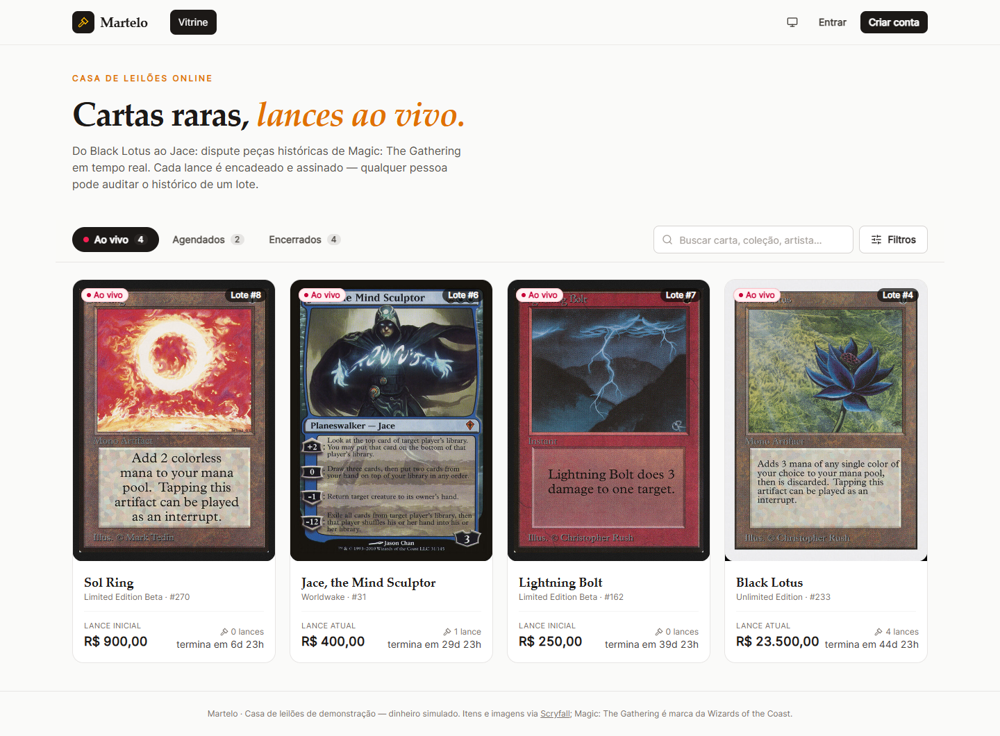
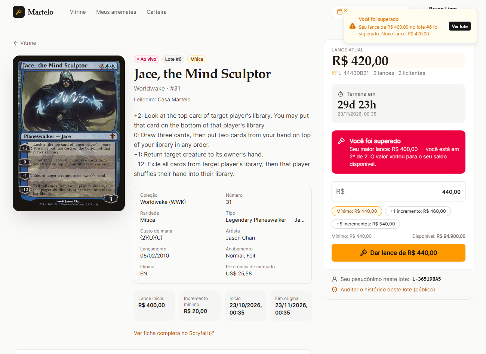
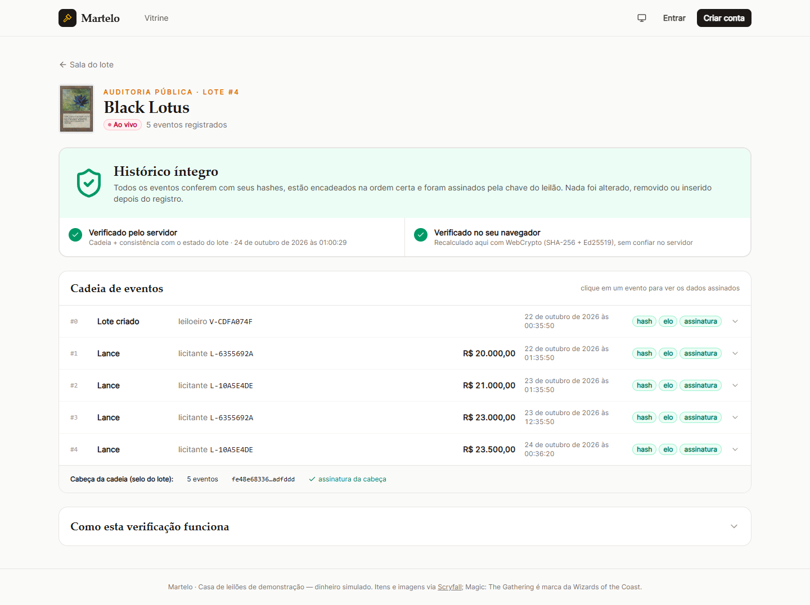
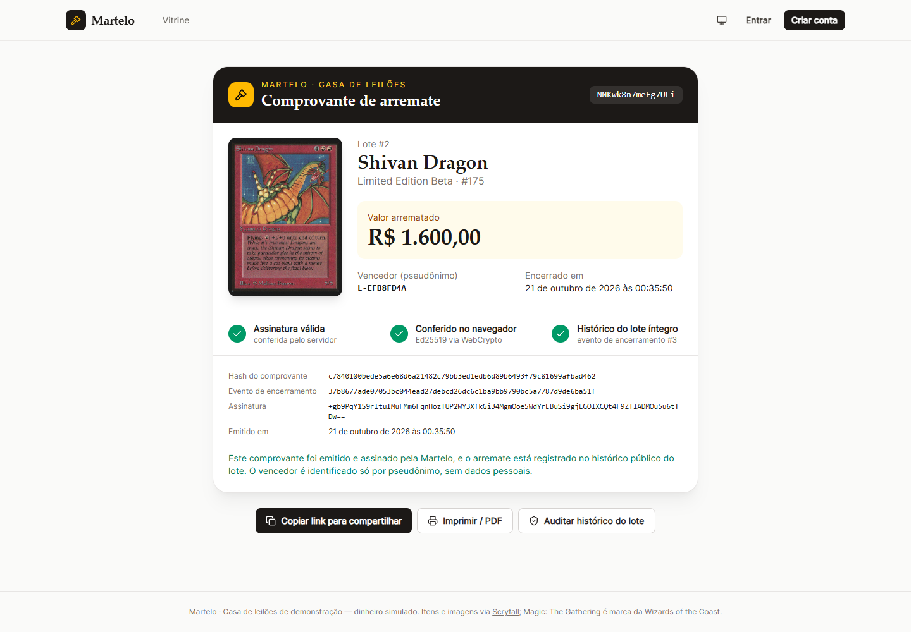
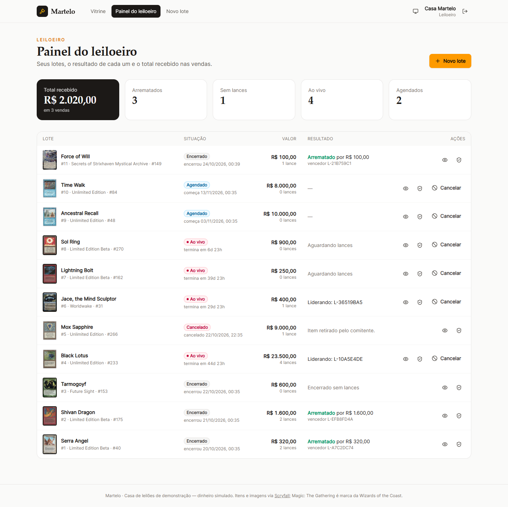
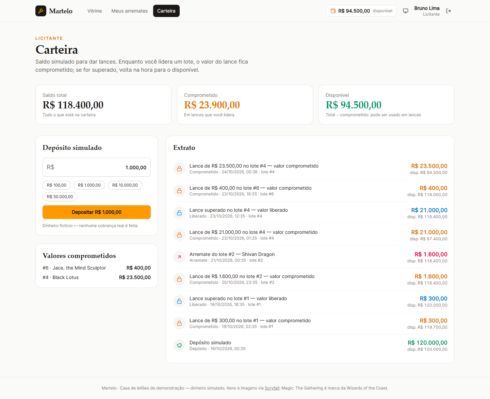

# Martelo — Casa de Leilões online

Casa de leilões de **cartas colecionáveis de Magic: The Gathering**. O leiloeiro busca uma carta na API pública do [Scryfall](https://scryfall.com/docs/api) e monta um lote. Os licitantes depositam saldo simulado e disputam o lote com lances ao vivo. Quem vence recebe um comprovante assinado, com link para compartilhar. Qualquer pessoa, mesmo sem login, pode auditar o histórico de lances de um lote e conferir que ele não foi adulterado.

> **Deploy:** _(link público aqui)_
> **Contas de demonstração** (senha `demo1234`): `leiloeiro@demo.com` · `ana@demo.com` · `bruno@demo.com`. A tela de login tem botões de acesso rápido.

| Vitrine | Sala do lote (ao vivo) | Auditoria pública |
| --- | --- | --- |
|  |  |  |

| Comprovante | Painel do leiloeiro | Carteira |
| --- | --- | --- |
|  |  |  |

---

## Sumário

1. [O que foi entregue](#1-o-que-foi-entregue)
2. [Como rodar](#2-como-rodar)
3. [Roteiro rápido de avaliação](#3-roteiro-rápido-de-avaliação)
4. [Arquitetura](#4-arquitetura)
5. [Regras de lance e dinheiro](#5-regras-de-lance-e-dinheiro)
6. [Histórico à prova de adulteração](#6-histórico-à-prova-de-adulteração)
7. [Privacidade](#7-privacidade)
8. [API externa e resiliência](#8-api-externa-e-resiliência)
9. [Tempo real](#9-tempo-real)
10. [Endpoints](#10-endpoints)
11. [Testes](#11-testes)
12. [Deploy](#12-deploy)
13. [Comportamentos que podem surpreender e limitações](#13-comportamentos-que-podem-surpreender-e-limitações)

---

## 1. O que foi entregue

**Requisitos do desafio**

| Requisito | Onde |
| --- | --- |
| Papéis leiloeiro (cria lotes, não dá lances) e licitante (deposita, dá lances, arremata) | Cadastro com escolha de papel; bloqueio na rota **e** no serviço |
| Vitrine com lotes ao vivo / agendados / encerrados; cancelados não aparecem | `/` |
| Painel do leiloeiro: buscar item na API, criar lote, cancelar lote sem lances, resultado de cada lote encerrado e total recebido | `/painel`, `/painel/novo-lote` |
| Sala do lote ao vivo: lance atual, histórico, posição do usuário, contagem regressiva, "você está ganhando"/"você foi superado", sem recarregar | `/lotes/:id` (Socket.IO) |
| Carteira: saldo total, comprometido, disponível e depósito simulado | `/carteira` (com extrato) |
| Meus arremates: lotes em que deu lance e lotes vencidos com comprovante e link | `/meus-arremates` |
| Página de auditoria pública, sem login, dizendo se o histórico está íntegro | `/auditoria/:id` |
| Mensagem clara para cada lance recusado | Abaixo do mínimo, saldo insuficiente, já está ganhando, lote não iniciado, lote encerrado (e cancelado) |
| Regras de lance, saldo comprometido, anti-sniping, liquidação | [Seção 5](#5-regras-de-lance-e-dinheiro) |
| Histórico à prova de adulteração (inclusive mexendo direto no banco) | [Seção 6](#6-histórico-à-prova-de-adulteração) |
| Auditoria e comprovante sem dados pessoais | [Seção 7](#7-privacidade) |
| Vitrine, salas, auditoria e comprovante funcionam com a API externa fora do ar | [Seção 8](#8-api-externa-e-resiliência) |
| Dados de teste: 1 leiloeiro, 2 clientes, lote publicado com lances abertos | Seed automático ([seção 2](#contas-e-dados-de-demonstração)) |

**Opcionais (todos implementados)**

- **Busca e filtro de lotes:** texto (título, coleção, artista), raridade, faixa de preço, ordenação e contagem por aba.
- **Cancelamento com estorno automático:** o leiloeiro pode cancelar mesmo com lances; o valor comprometido do líder volta na hora para o saldo disponível dele.
- **Docker Compose:** `docker compose up --build` sobe banco + aplicação já com dados.
- **Testes automatizados:** 74 testes (unitários + integração contra Postgres real, incluindo concorrência e adulteração).
- **Dark mode:** claro / escuro / seguir o sistema, sem "piscar" no carregamento.

**Stack:** React 19 + Vite + Tailwind CSS 4 + TanStack Query · Node.js 22 + Express 5 + Prisma 6 + Socket.IO · PostgreSQL 17 · TypeScript em tudo, num monorepo com npm workspaces.

---

## 2. Como rodar

### Opção A — Docker Compose (um comando)

Pré-requisito: Docker.

```bash
docker compose up --build
```

Abra **http://localhost:3000**. Na primeira subida a aplicação aplica as migrations e cria os dados de demonstração (`SEED_ON_BOOT=true`). O Postgres fica exposto em `localhost:5433` (usuário/senha/banco: `leilao`).

> As chaves do `docker-compose.yml` são **de demonstração** e estão no repositório de propósito, para o projeto subir sem configuração. Elas servem **só para rodar localmente**: em produção a aplicação se recusa a iniciar com elas (quem as conhecesse poderia forjar sessões e assinaturas da auditoria). Para o deploy, gere chaves novas com `npm run keys:generate`.

### Opção B — Desenvolvimento local

Pré-requisitos: Node.js 22+, npm 10+ e Docker (só para o Postgres).

```bash
npm install                          # instala todos os workspaces
cp apps/api/.env.example apps/api/.env
npm run db:up                        # sobe só o Postgres (porta 5433), já cria também o banco leilao_test
npm run db:migrate                   # aplica as migrations (prisma migrate dev)
npm run db:seed                      # dados de demonstração (idempotente)
npm run dev                          # API em :3333 e front em :5173 (com proxy para a API)
```

Abra **http://localhost:5173**.

Outros comandos úteis:

| Comando | O que faz |
| --- | --- |
| `npm test` | Testes do pacote compartilhado e da API (precisa do Postgres no ar) |
| `npm run typecheck` | Checagem de tipos de todos os workspaces |
| `npm run db:reset` | Apaga o banco de desenvolvimento, reaplica migrations e roda o seed |
| `npm run keys:generate` | Gera `JWT_SECRET`, `AUDIT_PRIVATE_KEY` e `PSEUDONYM_SECRET` novos |
| `npm run build && npm start` | Build de produção (front + API) e sobe tudo numa porta só |

### Banco de dados

- **PostgreSQL 17.** O schema está em [`apps/api/prisma/schema.prisma`](apps/api/prisma/schema.prisma) e a migration em [`apps/api/prisma/migrations`](apps/api/prisma/migrations).
- A migration, além das tabelas, cria regras que o próprio banco garante: `CHECK` de saldo (o comprometido nunca fica negativo nem maior que o total), `CHECK` de preços positivos e do fim depois do início, e um **trigger que bloqueia `UPDATE`/`DELETE`** no histórico de eventos.
- Dinheiro é sempre **centavos em `BIGINT`** (nunca float). Datas são `timestamptz(3)`.
- Os testes usam um banco separado (`leilao_test`, criado por [`docker/postgres/init-test-db.sql`](docker/postgres/init-test-db.sql)), então rodar os testes não apaga os dados de desenvolvimento.

### Variáveis de ambiente (`apps/api/.env`)

| Variável | Obrigatória em produção | Descrição |
| --- | --- | --- |
| `DATABASE_URL` | sim | Conexão com o Postgres |
| `JWT_SECRET` | sim | Assina o cookie de sessão (≥ 32 caracteres) |
| `AUDIT_PRIVATE_KEY` | sim | Semente Ed25519 (32 bytes em base64) que **assina o histórico**. Nunca vai para o banco |
| `PSEUDONYM_SECRET` | sim | Segredo do HMAC que gera os pseudônimos dos licitantes |
| `PORT` | não | Padrão `3333` (Docker/Railway usam `3000`/`$PORT`) |
| `SEED_ON_BOOT` | não | `true` cria os dados de demonstração na subida (idempotente) |
| `ALLOW_DEMO_SECRETS` | não | Em produção, a aplicação **se recusa a subir** com os segredos públicos de demonstração. O `docker-compose.yml` local liga esta flag; no deploy, nunca |
| `COOKIE_SECURE` | não | Padrão `true` em produção. Use `false` para rodar em `http://` |
| `SCRYFALL_BASE_URL` | não | Padrão `https://api.scryfall.com`. Aponte para algo inválido para simular a API fora do ar |
| `TEST_DATABASE_URL` | não | Banco dos testes (padrão `…/leilao_test`) |

Fora de produção, os três segredos têm valores padrão de desenvolvimento, para o projeto subir sem configuração. Em produção, a falta de qualquer um, ou o uso dos valores de demonstração que estão neste repositório, derruba a aplicação logo na subida, com mensagem explicando o que falta.

### Contas e dados de demonstração

O seed ([`apps/api/src/seed/seed.ts`](apps/api/src/seed/seed.ts)) passa pelos **mesmos serviços da aplicação**, com o relógio injetado no passado. Por isso lances, extrato, cadeia de auditoria e comprovantes são idênticos aos reais. As datas são relativas ao momento da primeira subida:

| Conta (senha `demo1234`) | Papel | Situação inicial |
| --- | --- | --- |
| `leiloeiro@demo.com` (Casa Martelo) | Leiloeiro | 10 lotes; já recebeu R$ 1.920,00 em vendas |
| `ana@demo.com` (Ana Souza) | Licitante | R$ 149.680,00 de saldo; lidera o Black Lotus (R$ 23.000 comprometidos); venceu o Serra Angel |
| `bruno@demo.com` (Bruno Lima) | Licitante | R$ 118.400,00 de saldo; lidera o Jace; venceu o Shivan Dragon |

| Lote | Situação |
| --- | --- |
| Black Lotus | **Ao vivo com disputa** (3 lances), termina em 45 dias |
| Jace, the Mind Sculptor | Ao vivo com 1 lance, termina em 30 dias |
| Lightning Bolt, Sol Ring | Ao vivo sem lances (40 e 7 dias) |
| Ancestral Recall, Time Walk | Agendados (começam em 10 e 20 dias) |
| Shivan Dragon, Serra Angel | Encerrados e arrematados (com comprovante) |
| Tarmogoyf | Encerrado sem lances |
| Mox Sapphire | Cancelado depois de receber lance: mostra o estorno no extrato da Ana |

---

## 3. Roteiro rápido de avaliação

1. **Vitrine sem login:** troque as abas, busque `christopher` (artista do Black Lotus) e abra os filtros.
2. **Lance ao vivo:** entre como **Bruno** e abra o **Black Lotus**. Em uma janela anônima, entre como **Ana** na mesma sala. Dê um lance com o Bruno: a tela da Ana muda para **"Você foi superado"** sem recarregar e o valor dela volta para o disponível (veja o chip de saldo no topo).
3. **Lances recusados:** tente um valor abaixo do mínimo; tente cobrir o próprio lance (o líder não vê o formulário, mas a API responde `ALREADY_WINNING`); digite um valor maior que o saldo; abra **Time Walk** (agendado). Cada caso mostra o motivo.
4. **Anti-sniping e liquidação:** entre como **leiloeiro** → *Novo lote* → busque uma carta → duração **3 min** → publicar. Como Ana, dê um lance quando faltar menos de 2 min: o fim é prorrogado (badge "Prorrogado 1×"). Quando acabar, a liquidação roda em ~1 s: Ana recebe o aviso de arremate, o comprovante aparece em *Meus arremates* e o painel do leiloeiro soma o total recebido.
5. **Comprovante:** em *Meus arremates*, copie o link e abra numa janela sem login. As assinaturas são conferidas também no navegador.
6. **Cancelamento com estorno:** no painel do leiloeiro, cancele o Jace (que tem lance do Bruno). O valor volta para o disponível do Bruno e o lote some da vitrine.
7. **Auditoria e adulteração** (precisa do Docker local):

   ```bash
   docker compose exec db psql -U leilao -d leilao
   ```
   ```sql
   -- Simula um DBA mal-intencionado: desliga o trigger e "melhora" um lance do Black Lotus.
   ALTER TABLE lot_events DISABLE TRIGGER lot_events_append_only;
   UPDATE lot_events SET amount_cents = amount_cents + 100
    WHERE lot_id = (SELECT id FROM lots WHERE title = 'Black Lotus') AND seq = 1;
   ALTER TABLE lot_events ENABLE TRIGGER lot_events_append_only;
   ```
   Recarregue `/auditoria/<id do Black Lotus>`: aparece **"Histórico adulterado"**, apontando o evento #1. Para desfazer, rode o mesmo bloco com `- 100`.
8. **API externa fora do ar:** suba a API com `SCRYFALL_BASE_URL=http://127.0.0.1:9`. Vitrine, salas, lances, auditoria e comprovantes continuam normais. A busca do leiloeiro responde com o cache, ou com uma mensagem clara se não houver cache.

---

## 4. Arquitetura

```
.
├── apps/
│   ├── api/                 Express 5 + Prisma + Socket.IO
│   │   ├── prisma/          schema e migrations (CHECKs + trigger append-only)
│   │   ├── src/
│   │   │   ├── modules/
│   │   │   │   ├── auth/        cadastro, login, sessão em cookie httpOnly
│   │   │   │   ├── wallet/      saldo, comprometido, extrato, locks de carteira
│   │   │   │   ├── catalog/     cliente Scryfall (retry, timeout, circuit breaker, cache)
│   │   │   │   ├── lots/        criação, cancelamento, vitrine, sala, painel
│   │   │   │   ├── bids/        placeBid: o coração das regras de lance
│   │   │   │   ├── settlement/  liquidação e comprovante
│   │   │   │   ├── audit/       assinatura, cadeia de eventos, verificação
│   │   │   │   └── images/      imagens copiadas da API externa, servidas do banco
│   │   │   ├── realtime/    Socket.IO (salas por lote e por usuário)
│   │   │   ├── jobs/        agendador (liquidação a cada 1 s)
│   │   │   └── seed/        dados de demonstração
│   │   └── test/            testes de integração
│   └── web/                 React + Vite + Tailwind
│       └── src/ (pages, components, hooks, lib)
└── packages/
    └── shared/              código usado pela API e pelo navegador:
                             regras de lance, cadeia de auditoria, DTOs, dinheiro
```

Decisões principais:

- **Monorepo com pacote compartilhado.** As regras de lance (`validateBid`) e a verificação da cadeia (`verifyChain`) são o **mesmo código** no servidor e no navegador. A auditoria pública recalcula tudo localmente, e o front avisa na hora usando as mesmas regras (quem decide continua sendo a API).
- **Uma origem só.** Em produção, a API serve o front buildado. Isso deixa o cookie de sessão `httpOnly` + `SameSite=Lax` e o WebSocket simples, sem CORS. Em desenvolvimento, o Vite faz proxy de `/api` e `/socket.io`.
- **Status derivado do relógio, não de uma coluna.** `SCHEDULED`/`LIVE`/`ENDED` vêm de `startsAt`, `endsAt`, `closedAt` e `cancelledAt` ([`lot-status.ts`](packages/shared/src/lot-status.ts)). Um agendador atrasado nunca deixa um lote "ao vivo" depois da hora, porque o lance é validado contra o relógio.
- **Express + Prisma**, sem framework mais pesado: o domínio é pequeno, e as partes críticas (locks, transações) ficam explícitas no código. O Prisma cuida de migrations e tipos; os `SELECT … FOR UPDATE` são SQL direto.

---

## 5. Regras de lance e dinheiro

Tudo em [`bids.service.ts`](apps/api/src/modules/bids/bids.service.ts) e [`bid-rules.ts`](packages/shared/src/bid-rules.ts).

**Fluxo de um lance** (uma transação):

1. `SELECT … FROM lots WHERE id = $1 FOR UPDATE`: **trava a linha do lote**. Lances simultâneos no mesmo lote entram em fila, e cada um valida contra o estado já atualizado pelo anterior. Sem isso, dois lances concorrentes passariam na validação com o mesmo "lance atual".
2. Trava as carteiras do novo licitante e do líder anterior, **sempre em ordem de id**. A ordem global de locks é lote → carteiras, o que evita deadlock.
3. Valida, nesta ordem: lote cancelado → não iniciado → encerrado (`agora ≥ fim`) → **líder não cobre o próprio lance** → **mínimo** (1º lance ≥ lance inicial; os seguintes ≥ atual + incremento) → **saldo disponível**.
4. Compromete o valor do novo líder e devolve na hora o do líder anterior. Cada movimento gera uma linha de extrato.
5. Anexa o evento assinado na cadeia de auditoria e atualiza o lote (preço, líder, prorrogação, cabeça da cadeia).
6. **Só depois do COMMIT** o lance é anunciado em tempo real.

**Saldo comprometido:** `disponível = total − comprometido`. Só o lance **líder** fica comprometido; quem é superado recupera o valor imediatamente. Um lance só é aceito se couber no disponível, o que já desconta o que o licitante lidera em outros lotes. O banco reforça com `CHECK (committed ≤ balance AND committed ≥ 0)`.

**Anti-sniping:** um lance aceito quando faltam **2 minutos ou menos** faz o lote terminar **2 minutos depois do lance** (`novo fim = momento do lance + 2 min`). Não há limite de prorrogações. O fim original fica guardado (`originalEndsAt`) e a sala mostra quantas prorrogações houve.

**Liquidação** ([`settlement.service.ts`](apps/api/src/modules/settlement/settlement.service.ts)): um agendador roda a cada segundo. Para cada lote vencido, uma transação com `FOR UPDATE SKIP LOCKED`: debita o vencedor (saldo e comprometido), credita o leiloeiro, sela o evento `LOT_CLOSED` na cadeia e emite o comprovante assinado. Lote sem lances fecha sem vencedor. A operação é idempotente e segura com mais de uma instância.

**Cancelamento:** sem lances, o lote é cancelado direto. Com lances (opcional), o valor comprometido do líder é estornado na hora. Os dois casos ficam registrados na cadeia (`LOT_CANCELLED`) e todos os licitantes do lote são avisados. Lotes encerrados não podem ser cancelados.

---

## 6. Histórico à prova de adulteração

**Técnica: log de eventos encadeado por hash (SHA-256) + assinatura digital (Ed25519), com a chave privada fora do banco.** Implementação em [`packages/shared/src/audit.ts`](packages/shared/src/audit.ts).

Cada lote tem um log append-only (`lot_events`): `LOT_CREATED` (gênese, com as condições do lote), `BID_PLACED`, e no fim `LOT_CLOSED` ou `LOT_CANCELLED`.

```
 evento #0 (LOT_CREATED)      evento #1 (BID_PLACED)       evento #2 (BID_PLACED)
┌───────────────────────┐    ┌───────────────────────┐    ┌───────────────────────┐
│ prevHash = 000…000    │ ┌─▶│ prevHash = H0         │ ┌─▶│ prevHash = H1         │
│ lote, condições, data │ │  │ L-6355692A, R$ 20.000 │ │  │ L-10A5E4DE, R$ 21.000 │
│ H0 = SHA-256(canon.)  │─┘  │ H1 = SHA-256(canon.)  │─┘  │ H2 = SHA-256(canon.)  │
│ assinatura Ed25519(H0)│    │ assinatura Ed25519(H1)│    │ assinatura Ed25519(H2)│
└───────────────────────┘    └───────────────────────┘    └───────────────────────┘
                                         cabeça do lote: { tamanho: 3, H2, assinatura }
```

1. Cada evento é serializado de forma **canônica** (chaves ordenadas, dinheiro em string de centavos, datas ISO em UTC) e inclui o **hash do evento anterior**.
2. `hash = SHA-256(serialização)`. Mudar qualquer campo muda o hash, e o evento seguinte deixa de "apontar" para ele.
3. Cada hash é **assinado com Ed25519**. A chave privada fica só na variável de ambiente `AUDIT_PRIVATE_KEY`, nunca no banco. A chave pública é publicada na página de auditoria e em `GET /api/audit/public-key`.
4. O lote guarda a **cabeça da cadeia assinada** (tamanho + último hash). As assinaturas usam prefixos diferentes para evento, cabeça e comprovante, então uma não serve no lugar da outra.
5. O servidor faz ainda **checagens de consistência** que só ele consegue: o preço atual, o líder, o fim e o vencedor do lote precisam bater com a cadeia, e cada pseudônimo precisa corresponder ao usuário interno do evento.
6. A página pública verifica **duas vezes**: no servidor e no navegador do visitante (WebCrypto, mesmo código), usando só a chave pública. Ninguém precisa confiar no veredito do servidor.

**O que é detectado** (cada caso tem teste em [`audit.test.ts`](apps/api/test/audit.test.ts) e [`audit.test.ts` do shared](packages/shared/test/audit.test.ts)):

| Ataque direto no banco | Como é pego |
| --- | --- |
| Alterar valor, horário ou autor de um lance | hash não confere (`HASH_MISMATCH`) |
| Alterar e recalcular todos os hashes | assinaturas não conferem (`BAD_SIGNATURE`, `BAD_HEAD_SIGNATURE`): sem a chave privada não dá para assinar |
| Remover um lance do meio | buraco na sequência + elo quebrado (`SEQUENCE_GAP`, `BROKEN_LINK`) |
| Remover o(s) último(s) lance(s) e "consertar" o lote | a cabeça assinada não bate (`BAD_HEAD_SIGNATURE`) |
| Inserir um lance forjado | assinatura inválida + tamanho da cadeia diferente |
| Reatribuir um lance a outro usuário (`actor_id`) | pseudônimo não corresponde ao HMAC do usuário (`STATE_MISMATCH`) |
| Mudar preço, líder, fim ou condições direto na tabela `lots` | estado do lote diverge da cadeia (`STATE_MISMATCH`) |

**Defesa em profundidade:** o trigger `lot_events_append_only` impede `UPDATE`/`DELETE` acidentais ou pela aplicação. A detecção, porém, **não depende dele**: um DBA pode desligá-lo, e os testes fazem justamente isso.

**Limites honestos:** quem tiver a **chave privada** consegue reescrever a história. Quem restaurar o banco inteiro a partir de um backup antigo (*rollback* completo e consistente) também não é detectado só pela cadeia. Em produção, as mitigações seriam guardar a chave num KMS/HSM e **ancorar periodicamente as cabeças das cadeias fora do sistema** (log público, e-mail aos licitantes, timestamping). O comprovante, que fica com o vencedor, já carrega o hash do evento de encerramento e funciona como uma âncora parcial.

---

## 7. Privacidade

- Na auditoria, na sala e no comprovante, licitantes aparecem só como **pseudônimo**, por exemplo `L-3FA9C2D1`. O pseudônimo é `HMAC-SHA256(PSEUDONYM_SECRET, loteId:usuárioId)`.
- O mesmo licitante tem pseudônimos **diferentes em cada lote**. Ninguém consegue montar o histórico de compras de uma pessoa cruzando auditorias.
- Nome, e-mail e id interno nunca saem nas respostas públicas. Há testes garantindo isso.
- O link do comprovante usa um código aleatório (96 bits), não um id sequencial.
- Senhas com `scrypt` + salt. A sessão fica em cookie `httpOnly` (o JavaScript da página não lê o token) com `SameSite=Lax`, e há rate limit em login e lances.

---

## 8. API externa e resiliência

Itens vêm do **Scryfall** (cartas de Magic). Escolhi essa API porque é pública, sem chave, estável e com imagens de qualidade. A primeira opção, o acervo do Art Institute of Chicago, bloqueia download de imagem por servidor. Detalhes em [`scryfall.ts`](apps/api/src/modules/catalog/scryfall.ts) e [`catalog.service.ts`](apps/api/src/modules/catalog/catalog.service.ts).

- **Snapshot na criação do lote:** dados **e imagem** do item são copiados para o banco (`catalog_items`, imagem em `bytea`). Vitrine, sala, auditoria e comprovante leem só daqui. A API externa não participa de nada depois que o lote existe.
- **Cliente com proteção:** timeout de 6 s, até 3 tentativas com backoff exponencial + jitter (respeitando `Retry-After`), intervalo mínimo de 100 ms entre chamadas (limite pedido pelo Scryfall) e **circuit breaker**: após 3 falhas seguidas, o servidor para de chamar a API por 30 s e responde direto do cache.
- **Busca com degradação graciosa:** cache fresco (10 min) → API → último resultado salvo da mesma busca → cartas já vistas com nome parecido → `503` com mensagem clara. Dá até para criar lote com a API fora, desde que a carta esteja no cache.
- `GET /api/health` mostra o estado do circuito.

---

## 9. Tempo real

Socket.IO na mesma origem, com duas salas:

- `lot:<id>`: qualquer pessoa (inclusive sem login) acompanhando a sala. Recebe `lot:update` (novo lance, preço, líder, novo fim), `lot:closed` e `lot:cancelled`.
- `user:<id>`: notificações pessoais (`notify`: superado, arrematou, vendeu, lote cancelado) e `wallet:update`. A sessão é lida do mesmo cookie `httpOnly`.

A vitrine recebe `lots:changed` e se atualiza sozinha. Ao reconectar, o front busca o estado completo de novo, para não perder eventos. A contagem regressiva usa o **relógio do servidor** (o offset é medido no carregamento), não o do computador do usuário.

---

## 10. Endpoints

Erros seguem sempre o formato `{ "error": { "code", "message", "details" } }`. Lance recusado = `422` com o código da regra (`BELOW_MINIMUM`, `INSUFFICIENT_FUNDS`, `ALREADY_WINNING`, `LOT_NOT_STARTED`, `LOT_ENDED`, `LOT_CANCELLED`).

| Método e rota | Acesso | Descrição |
| --- | --- | --- |
| `POST /api/auth/register` · `/login` · `/logout` | público | Cadastro (com papel), login e logout |
| `GET /api/auth/me` | público | Sessão atual + saldo (`null` se não logado) |
| `GET /api/lots?status=live\|scheduled\|ended&q&category&minPrice&maxPrice&sort&page` | público | Vitrine (nunca inclui cancelados) |
| `GET /api/lots/:id` | público | Sala do lote; com sessão inclui `viewer` (pseudônimo, posição, saldo) |
| `POST /api/lots` | leiloeiro | Cria lote a partir de um item do catálogo |
| `POST /api/lots/:id/cancel` | leiloeiro dono | Cancela (com estorno automático se houver lances) |
| `POST /api/lots/:id/bids` | licitante | Dá lance `{ amountCents }` |
| `GET /api/auctioneer/dashboard` | leiloeiro | Lotes, resultados e total recebido |
| `GET /api/me/participations` | licitante | Lotes em que deu lance, vencidos e comprovantes |
| `GET /api/wallet` · `POST /api/wallet/deposits` | licitante | Carteira com extrato · depósito simulado |
| `GET /api/catalog/search?q&page` | leiloeiro | Busca no Scryfall (com cache/fallback) |
| `GET /api/audit/lots/:id` · `GET /api/audit/public-key` | público | Cadeia + verificação · chave pública |
| `GET /api/receipts/:code` | público | Comprovante assinado + verificação |
| `GET /api/images/:itemId` | público | Imagem copiada do item |
| `GET /api/health` · `GET /api/time` | público | Saúde (banco + circuito) · hora do servidor |

---

## 11. Testes

```bash
npm run db:up   # Postgres precisa estar no ar
npm test
```

- **`packages/shared` (33 testes, unitários):** regras de lance, anti-sniping, status, conversão de dinheiro, canonicalização e verificação da cadeia contra cada tipo de adulteração.
- **`apps/api` (41 testes, integração contra Postgres real):**
  - regras de lance e saldo comprometido;
  - **concorrência:** 8 lances simultâneos de mesmo valor → exatamente 1 aceito; lances crescentes simultâneos; o mesmo licitante em dois lotes ao mesmo tempo não compromete mais do que tem;
  - anti-sniping, liquidação, cancelamento com estorno e idempotência;
  - **adulteração direta no banco**, com o trigger desligado (todos os cenários da tabela da seção 6);
  - **API externa fora do ar** (cache, fallback, circuit breaker);
  - rotas HTTP (papéis, validação, mensagens, sessão) e evento em tempo real via Socket.IO.

Os testes da API usam Postgres de verdade, e não mocks, porque o que mais importa aqui (locks, transações, `CHECK`s, trigger) só existe no banco.

---

## 12. Deploy

O projeto vira **uma única imagem Docker** ([`Dockerfile`](Dockerfile)), que roda as migrations e sobe a API servindo o front. Config pronta para o **Railway** em [`railway.json`](railway.json) (healthcheck em `/api/health`):

1. Novo projeto → *Deploy from GitHub repo* → selecionar este repositório.
2. Adicionar um **PostgreSQL** ao projeto e, no serviço da aplicação, criar `DATABASE_URL = ${{Postgres.DATABASE_URL}}`.
3. Gerar os segredos com `npm run keys:generate` e cadastrar `JWT_SECRET`, `AUDIT_PRIVATE_KEY` e `PSEUDONYM_SECRET`, além de `SEED_ON_BOOT=true`.
4. *Settings → Networking → Generate Domain*.

Qualquer plataforma que rode um container com Postgres (Render, Fly.io, uma VPS com `docker compose`) funciona do mesmo jeito.

---

## 13. Comportamentos que podem surpreender e limitações

- **Prorrogação:** o novo fim é "momento do lance + 2 min", e não "fim atual + 2 min". Assim sempre restam exatos 2 minutos para reagir depois de um lance de última hora. Prorrogações são ilimitadas.
- **Janela de lances** é `[início, fim)`: um lance exatamente no instante do fim já é recusado como encerrado.
- **Reinício do servidor:** o estado vive no banco e o agendador roda assim que a aplicação sobe, então lotes que venceram com o servidor fora do ar são liquidados no boot, com o horário real da liquidação registrado na cadeia.
- **Liquidação leva até ~1 s** depois do fim. Nesse intervalo a sala mostra "Encerrado — liquidando…". Lances já são recusados nesse período, porque a regra olha o relógio, não a liquidação.
- **Lances que não lideram não comprometem saldo.** Só o líder tem valor preso; ao ser superado, o valor volta na hora.
- **O leiloeiro não tem depósito.** A carteira dele só recebe o valor das vendas (aparece no painel). Leiloeiros não dão lance nem em lotes de outros leiloeiros.
- **Cancelar lote com lances é permitido** (opcional do desafio), com estorno automático. Lotes cancelados somem da vitrine, mas continuam acessíveis pelo link direto e pela auditoria. Lote encerrado não pode ser cancelado.
- **Busca de itens em inglês:** o Scryfall indexa nomes em inglês. A busca traz todas as impressões da carta, ordenadas pelo valor de mercado em dólar. O valor em dólar aparece só como referência, sem conversão para real.
- **Datas:** a interface mostra no fuso do navegador; as mensagens de erro geradas pelo servidor usam o horário de Brasília (está escrito na mensagem).
- **Verificação no navegador** precisa de suporte a Ed25519 no WebCrypto (Chrome 137+, Firefox 129+, Safari 17+). Em navegador antigo, a página avisa e mostra só o veredito do servidor.
- **Trocar a `AUDIT_PRIVATE_KEY`** muda a chave pública, e o histórico assinado antes deixa de verificar. Não implementei rotação de chaves (exigiria guardar um id de chave por evento).
- **Escala:** foi pensado para uma instância. A liquidação já é segura com várias (`SKIP LOCKED`), mas o Socket.IO precisaria do adaptador Redis para os eventos chegarem a clientes conectados em outras instâncias.
- **Fora do escopo** (como o desafio indica): nota fiscal, revenda entre usuários, app nativo e recuperação de senha.
